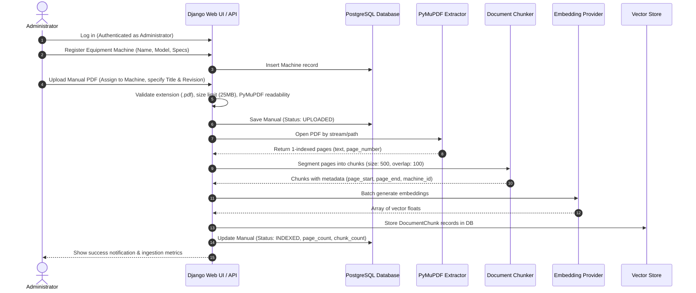
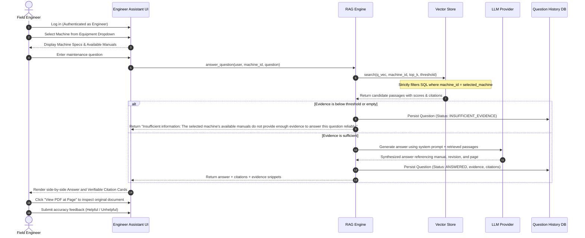
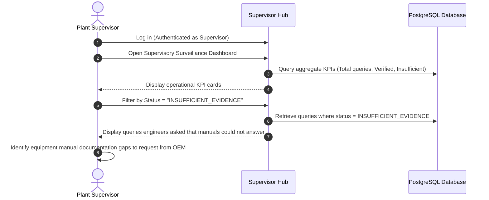

# Complete End-to-End Workflow

This document illustrates the three primary lifecycle workflows supported by the system: Ingestion, Inference, and Supervisory Audit.

---

## Workflow 1: Administrator Equipment & Manual Ingestion

---

## Workflow 2: Engineer Machine Selection & Question Answering

---

## Workflow 3: Supervisor Review & Documentation Gap Auditing

