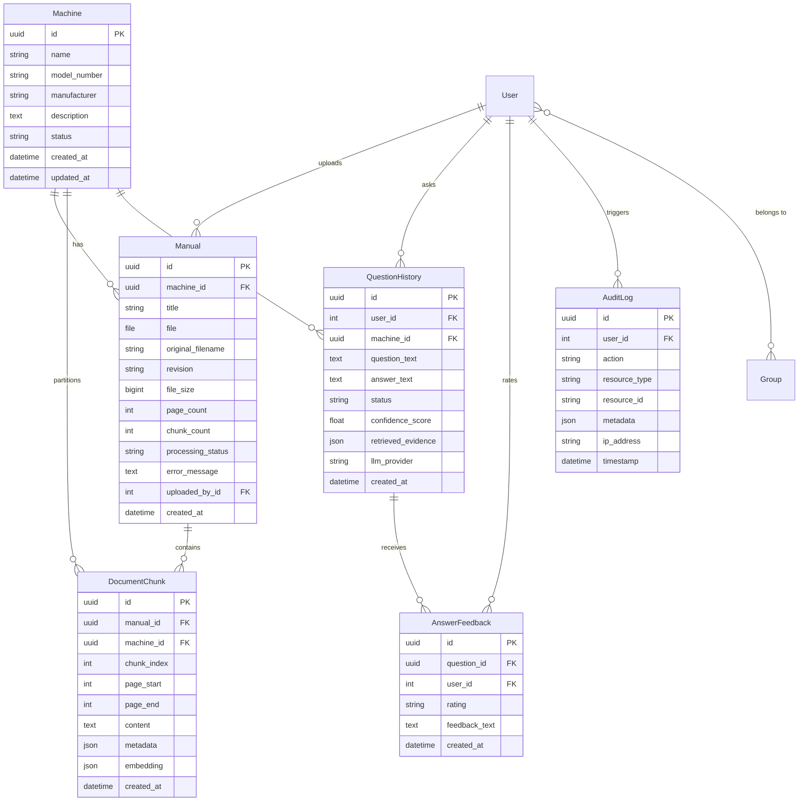

# Database Design & Schema Specification

The application utilizes a relational schema structured for Django and PostgreSQL, enforcing foreign key integrity, cascading deletions, and indexed queries.

---

## 1. Entity-Relationship Diagram

---

## 2. Table Schemas & Constraints

### `machines_machine`
- `id`: UUID (Primary Key, default uuid4).
- `name`: VARCHAR(200), NOT NULL. Equipment designation.
- `model_number`: VARCHAR(100), NOT NULL, Indexed.
- `manufacturer`: VARCHAR(150), BLANK=True.
- `description`: TEXT, BLANK=True.
- `status`: VARCHAR(30), Choices: `ACTIVE`, `MAINTENANCE`, `DECOMMISSIONED`.
- Indexes: `[model_number]`, `[status]`.

### `manuals_manual`
- `id`: UUID (Primary Key).
- `machine_id`: UUID (Foreign Key -> `machines_machine.id`, ON DELETE CASCADE).
- `title`: VARCHAR(255), NOT NULL.
- `file`: VARCHAR(100), File path relative to `MEDIA_ROOT`.
- `original_filename`: VARCHAR(255).
- `revision`: VARCHAR(50), default 'Rev 1.0'.
- `processing_status`: VARCHAR(30), Choices: `UPLOADED`, `PROCESSING`, `INDEXED`, `FAILED`. Indexed.
- `uploaded_by_id`: INT (Foreign Key -> `auth_user.id`, ON DELETE SET_NULL, Nullable).

### `document_processing_documentchunk`
- `id`: UUID (Primary Key).
- `manual_id`: UUID (Foreign Key -> `manuals_manual.id`, ON DELETE CASCADE).
- `machine_id`: UUID (Foreign Key -> `machines_machine.id`, ON DELETE CASCADE, Indexed).
- `chunk_index`: INT, sequence index within document.
- `page_start`: INT, 1-indexed start PDF page.
- `page_end`: INT, 1-indexed end PDF page.
- `content`: TEXT, passage body.
- `metadata`: JSONField, contains `{machine_id, manual_id, manual_title, revision, page_number}`.
- `embedding`: JSONField, floating-point vector array.
- Composite Indexes: `[machine_id, manual_id]`, `[machine_id, page_start]`.

### `question_history_questionhistory`
- `id`: UUID (Primary Key).
- `user_id`: INT (Foreign Key -> `auth_user.id`, ON DELETE CASCADE).
- `machine_id`: UUID (Foreign Key -> `machines_machine.id`, ON DELETE CASCADE, Indexed).
- `question_text`: TEXT.
- `answer_text`: TEXT.
- `status`: VARCHAR(30), Choices: `ANSWERED`, `INSUFFICIENT_EVIDENCE`, `FAILED`. Indexed.
- `confidence_score`: FLOAT, top similarity score (0.0 to 1.0).
- `retrieved_evidence`: JSONField, list of serialized evidence objects.
- `created_at`: DATETIME, Indexed.
