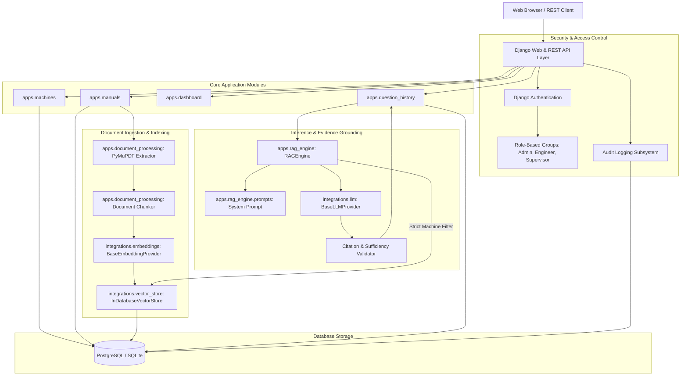

# System Architecture

## 1. High-Level Architecture Diagram

---

## 2. Component Decoupling & Interfaces

### 1. Ingestion Decoupling
The PDF extraction service (`PyMuPDFExtractor`) only interacts with binary PDF data and produces structured page dictionaries (`page_number`, `text`, `char_count`). It has no knowledge of database models or embedding services. The `DocumentChunker` processes arbitrary page text arrays and applies overlap while retaining page bounds.

### 2. Embedding Driver Decoupling
All embedding operations adhere to `BaseEmbeddingProvider` (`embed_text`, `embed_batch`, `dimension`). Switching from local/mock embeddings to OpenAI or a self-hosted Sentence Transformer requires updating `EMBEDDING_PROVIDER` in `.env` without touching document extraction or the vector store.

### 3. Vector Retrieval & Machine Isolation
The vector store (`BaseVectorStore`) enforces `machine_id` partitioning. Queries filter by `machine_id` at the database index layer before computing vector similarity. This guarantees that Machine A never evaluates passages from Machine B.

### 4. LLM Provider Decoupling
The generation layer adheres to `BaseLLMProvider` (`generate_answer`). Whether running `mock`, `openai` (GPT-4o), `anthropic` (Claude 3.5 Sonnet), or `ollama` (Llama 3), the input/output schema remains identical.
